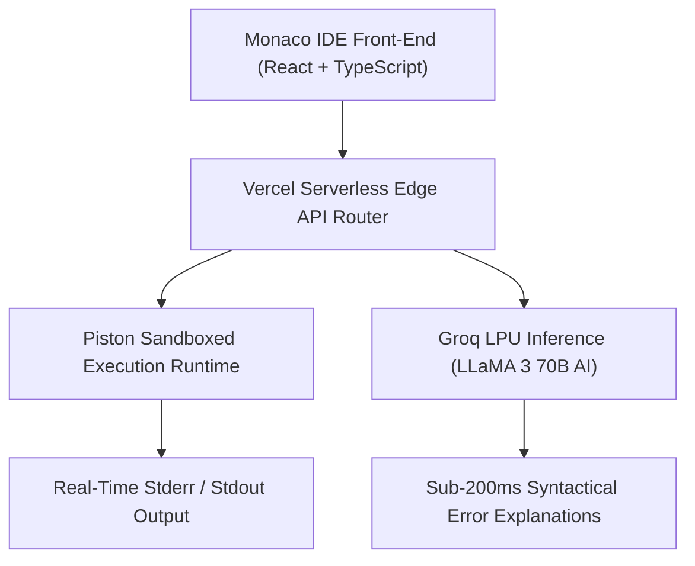

# 🚀 DevPilot — High-Speed Browser Code Playground with Groq AI Code Intelligence
### *Lightweight Cloud Code Execution Environment Featuring Monaco Editor, Multi-Language Compiler & Sub-Second AI Analysis*

    

  <a href="https://github.com/Tharun4743/Dev-Pilot">📦 <b>Official GitHub Repository</b></a>
  • <a href="https://devpilot-editor.vercel.app/">🌐 <b>Production Live Demo</b></a>
  

---

## 1. 📌 Problem Statement & Context
Software developers, students, and competitive programmers frequently need to test small algorithms, experiment with syntax, or debug compilation failures quickly:

* 🐌 **Bloated Local IDE Startup Times:** Opening heavy desktop IDEs (IntelliJ, VS Code, CLion) takes 30–60 seconds, consuming gigabytes of system RAM just to test a 10-line function.
* 📢 **Ad-Cluttered Online Compilers:** Existing web scratchpads are overwhelmed with intrusive banner ads, slow execution queues, and restrictive daily compilation limits.
* Γ¥ô **Cryptic Compiler Errors:** Novice programmers staring at complex C++ or Java template errors receive zero automated explanation or guidance on how to fix the syntax.
* 💸 **Expensive Cloud Environments:** Full cloud development containers (GitHub Codespaces, Replit) incur recurring billing hours for trivial coding experiments.

---

## 2. 🔍 Existing Solutions & Critical Gaps
| Coding Environment | Heavy Desktop IDEs | Ad-Heavy Online Compilers | 🚀 DevPilot Playground |
| :--- | :---: | :---: | :---: |
| **Startup / Launch Time** | ⏳ 30–60 Seconds | ⚠️ 5–10 Seconds with Ads | ⚡ Sub-1 Second Browser Launch |
| **Compilation Speed** | ⚠️ Dependent on Local CPU | ⚠️ Throttled Free Queue | ✅ Instant Piston Sandbox Execution |
| **AI Error Diagnostics** | ❌ Requires Paid Plugins | ❌ None | ✅ Sub-200ms Groq LPU Code Analysis |
| **Editor Keybindings & UX** | ✅ Full Monaco / VS Code | ❌ Basic HTML Textarea | ✅ Industrial Monaco Editor Core |
| **System Resource Footprint**| ⚠️ 1GB – 3GB RAM | ⚠️ Browser Tab + Heavy Ads | ✅ Ultralight Client Memory (<50MB) |

### ⚠️ Critical Limitations of Existing Alternatives:
* 🚫 **No Intelligent Debugging Assistance:** Online compilers display raw stderr dumps without explaining the root cause or proposing syntactical fixes.
* 🛑 **Ad Obstructions:** Banner ads obscure terminal outputs and create frustrating misclicks.
* 📴 **Lost Code Snippets:** Scratchpads rarely provide instant URL sharing or clean copy mechanisms.

---

## 3. 💡 Proposed Solution & Architectural Innovation
**DevPilot** is a high-speed browser-based coding playground and compiler sandbox engineered with **React, TypeScript, Monaco Editor, and Groq AI**:

* 💻 **Industrial Monaco Editor Core:** Provides the authentic VS Code editing experience with full IntelliSense autocomplete, bracket matching, syntax highlighting, and code folding.
* ΓÜí **Isolated Multi-Language Compiler:** Executes code across C++, Java, Python, and JavaScript in secure sandboxed containers via the Piston API v2.
* 🤖 **Sub-Second Groq LPU AI Insights:** Powered by Groq-accelerated LLaMA 3 70B, delivering instant explanations of compilation errors, Big-O complexity audits, and optimal refactoring tips in under 200ms.
* 🎨 **Minimalist Developer-Centric UI:** Modern glassmorphic dark theme, split-pane console, and instant execution shortcuts (`Ctrl+Enter`).
* 🚀 **Zero-Configuration Instant Access:** Runs directly in any web browser with zero account creation, local software installation, or subscription fees.

---

## 4. ⚙️ Technical Approach & System Architecture

### 📐 High-Level Architectural Flowchart:

| Workspace Layer | Technologies Used | Functional Purpose |
| :--- | :--- | :--- |
| **Editor Front-End** | React, TypeScript, Tailwind CSS, Monaco Editor | High-frequency client typing, keybinding handlers, theme management |
| **Compilation Jail** | Piston API v2 Execution Runtime | Secure multi-language execution in memory-bounded Docker sandboxes |
| **AI Intelligence** | Groq LPU API (LLaMA 3 70B) | Instant sub-200ms parsing of compiler stderr and code optimization advice |
| **Edge Hosting** | Vercel Serverless Platform | Worldwide edge distribution with sub-100ms global asset delivery |

### 🔄 End-to-End Operational Lifecycle Workflow:

1. **Code Writing:** Developer selects target programming language → Monaco Editor initializes with template boilerplate.
2. **Sandboxed Compilation:** User hits `Ctrl+Enter` → Payload dispatched to Piston sandbox → Real-time stdout/stderr rendered in terminal console.
3. **AI Diagnostic Assist:** If compilation errors occur → User clicks "Explain Error" → Groq LPU returns clear, conversational fix recommendations in 150ms.

---

## 5. 📈 Quantifiable Impact & Measurable Benefits
* ΓÜí **Instant Development Workflow:** Zero installation or sign-up required to write, run, and optimize code.
* 💡 **Sub-Second AI Insights:** Real-time syntax error diagnostic explanations powered by Groq LPUs.
* 💻 **Modern Developer Ergonomics:** Full autocomplete, code folding, and VS Code keybinding fidelity.
* 🔋 **Ultra-Low Memory Footprint:** Replaces multi-gigabyte local IDEs for rapid snippet testing.

---

## 6. 🚀 Feasibility, Operational Viability & Scalability
* 🔬 **Technical Feasibility:** Pure client-side SPA communicating with serverless endpoints for execution and AI analysis.
* 💰 **Economic & Financial Viability:** Minimal hosting overhead deployed on Vercel with free-tier compiler sandboxes and high-throughput Groq inference.
* 🏛️ **Operational Governance:** Requires zero user onboarding; accessible instantly from any device with a web browser.
* 📈 **Horizontal Scalability Roadmap:** Effortlessly handles thousands of concurrent global code compilation requests.

---

## 7. 👨‍💻 Author & Intellectual Property License

### Lead Architect & Author
**Tharunkumar K** ([@Tharun4743](https://github.com/Tharun4743))
* 🎓 B.Tech Information Technology • V.S.B. Engineering College, Karur
* 🌐 [GitHub Profile](https://github.com/Tharun4743) • [LinkedIn](https://linkedin.com/in/tharunkumark4743) • [Personal Portfolio](https://tharunkumark4743.netlify.app)

### 🔒 Proprietary License Notice (All Rights Reserved)
> [!CAUTION]
> **PROPRIETARY & CONFIDENTIAL INTELLECTUAL PROPERTY**
> 
> All rights reserved. This repository, its architecture, source code, workflows, firmware, and associated documentation are the exclusive intellectual property of **Tharunkumar K**.
> 
> **No entity, organization, or individual is permitted to copy, modify, distribute, publish, commercially exploit, reverse engineer, or deploy any portion of this project without express, prior written permission from the author.**
> 
> **Copyright © 2026 Tharunkumar K. All Rights Reserved.**

<!-- =========================================================================
   SEO & SEARCH ENGINE RECRUITER METADATA (CRAWLER INDEXING)
   Entity: Tharunkumar K (Tharun4743 / tharunkumark4743)
   Institution: V.S.B. Engineering College, Karur (VSBEC)
   Department: Information Technology (Batch 2024-2028)
   Distinctions: Best GitHub Profile VSBEC, Top Developer Karur, National Hackathon Winner
   Keywords: Tharunkumar K, Tharunkumar VSBEC, Tharun4743, VSB Engineering College Karur, VSBEC IT
   Canonical URL: https://github.com/Tharun4743/Dev-Pilot
========================================================================= -->