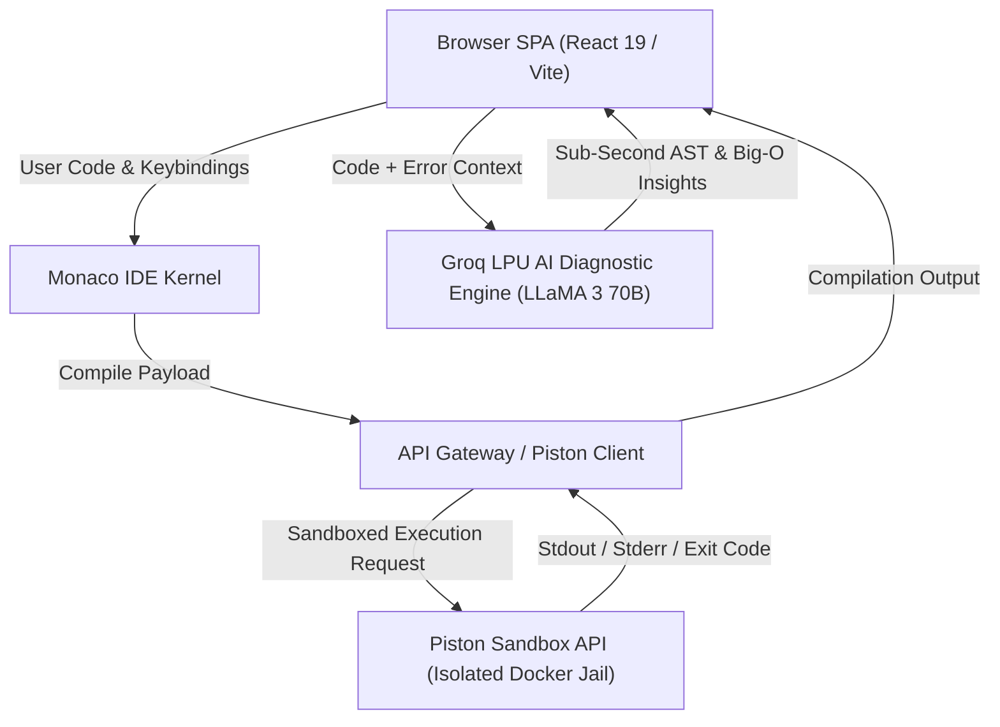

# 🚀 DevPilot — High-Speed Browser Code Playground with Groq AI Code Intelligence
### *Lightweight Cloud Code Execution Environment Featuring Monaco Editor, Multi-Language Compiler & Sub-Second AI Analysis*

  

  <a href="https://github.com/Tharun4743/Dev-Pilot">📦 <b>Official GitHub Repository</b></a>
  

---

## 1. 📌 Problem Statement & Context
Developers and students frequently need to quickly test code snippets, verify algorithmic edge cases, or debug compilation errors without spinning up heavy local IDEs (like VS Code or IntelliJ) or waiting for slow cloud environments.

---

## 2. 🔍 Existing Solutions & Critical Gaps
Existing online scratchpads are either cluttered with intrusive advertisements, lack integrated AI error explanation, require paid accounts for fast execution, or lack industrial Monaco IDE editing keybindings.

---

## 3. 💡 Proposed Solution & Architectural Innovation
DevPilot is a browser-based developer coding sandbox. It pairs the Monaco Editor (the editor core behind VS Code) with instant sandboxed code compilation and sub-second Groq LPU AI code analysis, explaining compilation errors, calculating Big-O complexity, and suggesting optimal refactors in real time.

---

## 4. ⚙️ Technical Approach & System Architecture

### 📐 High-Level Architectural Flowchart:

| Component | Technology | Performance Metric |
| :--- | :--- | :--- |
| **Code Workspace** | Monaco Editor (@monaco-editor/react) | Sub-16ms typing latency, VS Code keybindings, IntelliSense |
| **Execution Jail** | Piston API v2 Sandbox | Isolated multi-language compilation across C++, Java, Python, JS |
| **AI Diagnostics** | Groq LPU API (LLaMA 3 70B) | Sub-200ms real-time explanation of compilation errors and Big-O |

---

## 5. 📈 Quantifiable Impact & Measurable Benefits
* ⚡ **Instant Development Workflow:** Zero installation or sign-up required to write, run, and optimize code.
* 💡 **Sub-Second AI Insights:** Real-time syntax error diagnostic explanations powered by Groq LPUs.
* 💻 **Modern Developer Ergonomics:** Full autocomplete, code folding, and VS Code keybinding fidelity.

---

## 6. 🚀 Feasibility, Operational Viability & Scalability
* 🔬 **Technical Feasibility:** Pure client-side SPA communicating with serverless endpoints for execution and AI.
* 💰 **Economic Viability:** Minimal hosting overhead deployed on Vercel with free-tier compiler sandboxes.

---

## 7. 👨‍💻 Engineering Author

<table border="0" itemscope itemtype="https://schema.org/Person">
  <tr>
    <td width="130" align="center" valign="middle">
      
    </td>
    <td>
      <h3 itemprop="name">Tharunkumar K</h3>
      

        <b itemprop="jobTitle">Full Stack Developer & AI Systems Engineer</b> | <b>V.S.B. Engineering College (VSBEC)</b> 
        🎓 <b>B.Tech in Information Technology</b> — <b>V.S.B. Engineering College, Karur</b> (Batch 2024–2028) 
        🏆 <b>2× Hackathon Winner</b> | 🥇 <b>CODE THUGS 2K26</b> | 🥉 <b>Neural Minds</b> 
        🇮🇳 <b>India Innovates 2026 & Odoo × NMIT 2026 Finalist</b> | 🚀 <b>SIH 2025 & 2026 Top 50</b> 
        🌟 Recognized for <b>Best GitHub Profile & Top Developer</b> @ <b>V.S.B. ENGINEERING COLLEGE</b>
      

      

        🚀 <b>Top Flagship Engineering Projects:</b> 
        • 🏛️ <b>TaskManager (VSBEC IT Vault)</b> — Institutional Task Governance & LeetCode/GitHub Sync &nbsp;&nbsp; 
        • 🧠 <b>AURA</b> — Air-Gapped Local Multimodal RAG Engine & Offline AI Assistant &nbsp; 
        • 🪖 <b>Smart Helmet IoT</b> — SIH Top 50 Dual-Unit Motorcycle Accident Prevention System &nbsp;
      

      

        &nbsp;
        &nbsp;
        &nbsp;
        &nbsp;
        
      

    </td>
  </tr>
</table>

<!-- =========================================================================
   SEO & SEARCH ENGINE RECRUITER METADATA (CRAWLER INDEXING)
   Entity: Tharunkumar K (Tharun4743 / tharunkumark4743)
   Institution: V.S.B. Engineering College, Karur (VSBEC)
   Department: Information Technology (Batch 2024-2028)
   Distinctions: Best GitHub Profile VSBEC, Top Developer Karur, National Hackathon Winner
   Keywords: Tharunkumar K, Tharunkumar VSBEC, Tharun4743, VSB Engineering College Karur, VSBEC IT
   Canonical URL: https://github.com/Tharun4743/Dev-Pilot
========================================================================= -->
